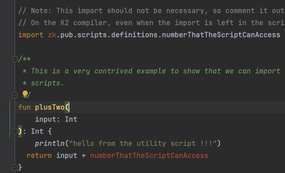
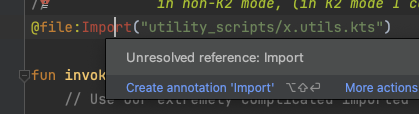
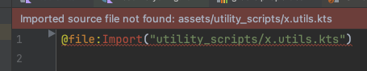

# Minimal Kotlin Scripting IDE Test Repo

Goals: Expose some IDE problems with Kotlin scripting using very simple examples that are derived from my very real codebase.

## Making the custom script definitions work in the IDE

The definitions (`ExampleScript`, `UtilityScript`) live in `:srcs:pub` and are published to mavenLocal as `zk:pub:<version>`. The root project depends on those coordinates, so the compiled definitions land on the classpath of the module that contains the scripts in `assets/`.

1. `./gradlew buildScriptDefinitions` (or just `./gradlew build`) - builds the definition jar and publishes it to mavenLocal.
2. Re-sync Gradle in the IDE.
3. **(2026.2.x only)** The IDE's own definition discovery is **broken in 2026.2**, so the definitions must be listed explicitly: Settings -> Build, Execution, Deployment -> Kotlin -> **Kotlin Scripting**:
   - **"Script definition classes to load:"** -> `zk.pub.scripts.definitions.UtilityScript, zk.pub.scripts.definitions.ExampleScript`
   - **"Classpath for loading script definitions:"** -> the absolute path of the published jar, e.g. `/Users/<you>/.m2/repository/zk/pub/0.1.0/pub-0.1.0.jar` (no `~` expansion)
   - **Apply** (one-time per machine; the values persist in `workspace.xml` and survive restarts)
4. Open a script in `assets/` - the banner should show the custom definition (`.utils.kts` / `.example.kts` instead of `.kts`). If it looks stale, run **Reload Script Configuration** in the script editor (Ctrl+Alt+Shift+R).

On 2026.3+ only steps 1-2 are needed - see [Appendix: what to simplify when 2026.3 lands](#appendix).

Background: since 2026.2 the IDE no longer discovers definitions from `.kt` source roots - they must come from a built artifact on the module classpath (per JetBrains on [KTIJ-40199](https://youtrack.jetbrains.com/issue/KTIJ-40199)). That's why this repo is structured the way it is. The 2026.2 breakage in step 3 (and why a settings toggle doesn't fix it) is documented with log evidence in [intellij_issue_draft_script_definition_discovery_2026_2.md](intellij_issue_draft_script_definition_discovery_2026_2.md).

### Troubleshooting: If it doesn't work

1. **The jar.** Re-run step 1 and confirm `~/.m2/repository/zk/pub/<version>/pub-<version>.jar` exists and is fresh (it should contain the `zk/pub/scripts/definitions/*.class` files and `META-INF/kotlin/script/templates/*.classname` touchfiles).
2. **Resolution.** `./gradlew dependencies --configuration compileClasspath` should show `zk:pub:<version>`, not `FAILED`.
3. **The sync.** Re-sync Gradle and make sure it succeeded (no unresolved-dependency warnings).
4. **2026.2.x: the explicit settings.** Step 3 must be filled in correctly - note that a mere settings toggle (uncheck/recheck) without filling in the two fields does *not* help.

# Problems with Kotlin Scripting that this repo shows:

For starters, you can confirm for yourself that the scripts compile and run by running the test at `srcs/pub/src/test/kotlin/zk/TestEverything.kt`. This can be done either via the IDE or with `./gradlew test`.

This is a very simple example and for the test to run, the script must run without errors and correctly import another script.

The IDE disagrees that this script works, however. See below.

## Problem 1: (K1 & K2) Scripts that import other scripts report the import as not being found on K1

This utilizes a feature wherein you need a script to be able to import and use another script.

My `Import` annotation is declared in `UserScriptCompilationConfiguration.kt` and this was created according to this example: https://github.com/Kotlin/kotlin-script-examples/blob/fec834e2a9a2c07c8486a684d3e131cb909015d7/jvm/simple-main-kts/simple-main-kts/src/main/kotlin/org/jetbrains/kotlin/script/examples/simpleMainKts/annotations.kt#L20

One relevant detail here is that I am using an override for where the imported scripts are relative to. A theory I have is that the IDE integration is not properly integrating with this feature.

This means the failure manifestation is not the same as that script example. As a side note, when I open that script example in my IDE and go through the troubleshooting steps listed earlier in this document, the import statement is found, but there is a false highlighting error when accessing the imported variable it seems:



### Manifestation 1: Import annotation not found

For K1: This happens when for whatever reason the IDE can't find the script definitions. I can usually move it to manifestation-2 by going through the troubleshooting tip I listed earlier by reordering and re-enabling the script definitions.

For K2: This seems to be the usual failure mode. Sometimes, I see manifestation-2 with K2, but can't consistently produce it.



Here the import annotation cannot be found by the IDE, but when the script actually runs, it is found because the function we imported is available.


### Manifestation 2: Red banner saying 'imported source file not found'

This one makes the whole file underlined in red, which is extra annoying.

Note that the path listed on the banner is actually incorrect. It should be using the path prefix that was provided to the import annotation (as this is how the script compiles and runs when you run the test!)



(This is tracked here: https://youtrack.jetbrains.com/issue/KTIJ-36841 )

# BONUS! I also show a work around for `scriptsInstancesSharing` not having the desired/intended performance.

Take a look inside of `UserScriptRegistry` to see how I use the compiled script instances.

The existing examples instead seem to run the script through the evaluators every time, which pays the class loading cost, which is huge (according to my benchmarks).

There's an 'instances sharing' configuration, which you would think would do this, but it doesn't seem to work (the performance cost is still big last time I checked).

Weird! Leaving it in the repo for an example for others to consider. Once these other problems are fixed maybe I should make an issue to track the instance sharing flag not seeming to work...


# System information from latest manual test

Last Tested: Oct 2026

Kotlin Version: 2.4.10

IDE Version:
```
IntelliJ IDEA 2026.2.3
Build #IU-262.10968.63, built on September 15, 2026
macOS 27.0.1 (arm64)
```

(Previous test round: IntelliJ IDEA 2026.2.1, Build #IU-262.9437.185, built on August 8, 2026 - this is where the discovery regression was first observed; 2026.1.4 worked.)

# Appendix

## What to simplify when 2026.3 lands

On `master` (what becomes 2026.3+) the discovery works again: markers are found by walking the class roots directly in the VFS (no `FilenameIndex`), module output directories are scanned again (a plain `project(":srcs:pub")` dependency would suffice), and the definition cache invalidates on syncs and builds.

Before simplifying, verify in the Kotlin plugin sources of your IDE's baseline. Release branches are named after the build baseline - e.g. `262.10968` corresponds to IU-262.10968.63 - so for a 2026.3 IDE (IU-263.xxxxx) check branch `263.xxxxx` on `JetBrains/intellij-community`:

1. `plugins/kotlin/base/scripting/scripting/src/org/jetbrains/kotlin/idea/core/script/definitions/DefinitionFromDependenciesProvider.kt` has a `markerCandidateRoots(project)` function (production output roots of all modules + class roots of all libraries) and finds the markers via `classRoot.findFileByRelativePath(SCRIPT_DEFINITION_MARKERS_PATH)` - no `FilenameIndex`.
2. In the same file, `getOrDiscover` is keyed on *both* `ScriptDefinitionsModificationTracker` and `ProjectRootModificationTracker`, and a `ScriptDefinitionsBuildListener.kt` exists in the same package.

(Verified against `master` HEAD on 2026-10-27; a local sparse checkout of branch `262.10968` plus `master`'s version of the file lives at `../misc_opensource_clones/kotlin_stuff/ic-262.10968` if you want to re-check.)

If both markers are present, simplify:

- Root `build.gradle.kts`: replace `implementation("zk:pub:$pubVersion")` with `implementation(project(":srcs:pub"))` and drop `mavenLocal()`; make `buildScriptDefinitions` depend on `:srcs:pub:classes` (the output dirs are scanned directly, no jar needed).
- `srcs/pub/build.gradle.kts`: drop the `maven-publish` plugin, `group`/`version`, and the kotlin-bom removal in `afterEvaluate`.
- `buildSrc/src/main/kotlin/Versions.kt`: drop `pubVersion`.
- IDE workflow: just build - new/changed definitions are picked up without a sync, restart, or settings (drop step 3 above). Discovery is still compiled-artifact-based (not `.kt` sources), and the `.classname` touchfiles are still required.
